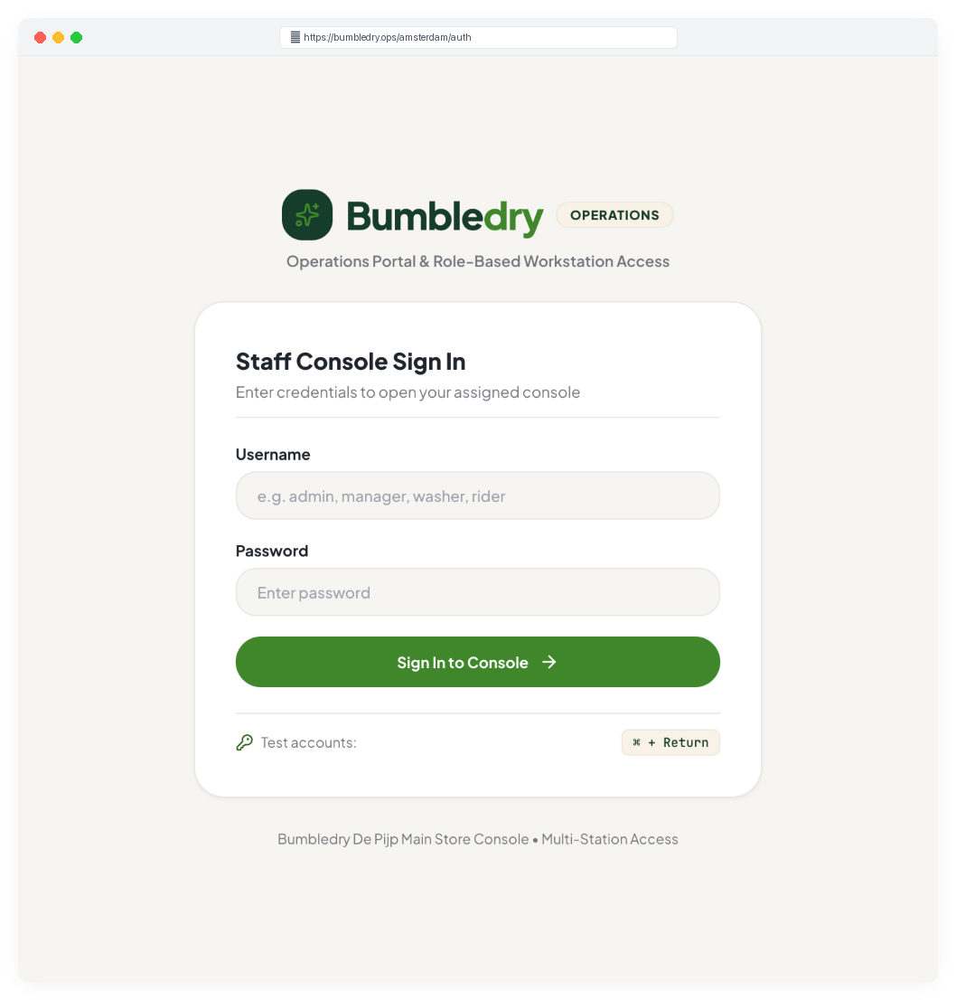
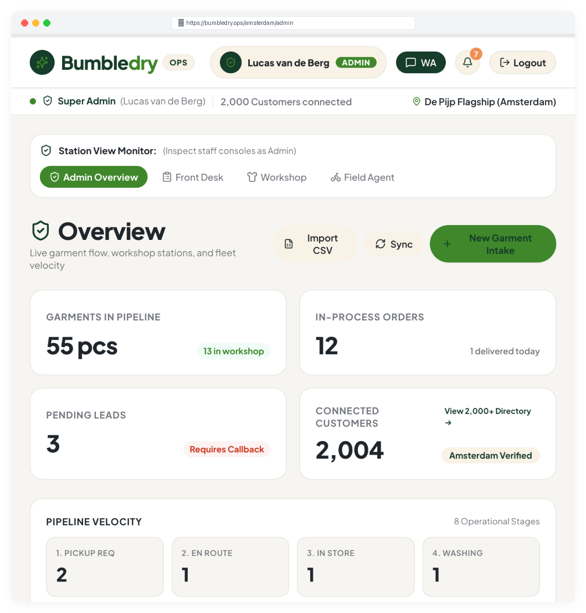
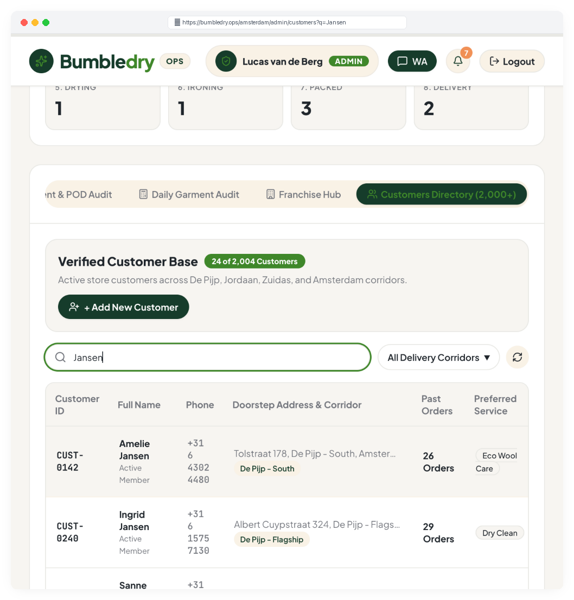
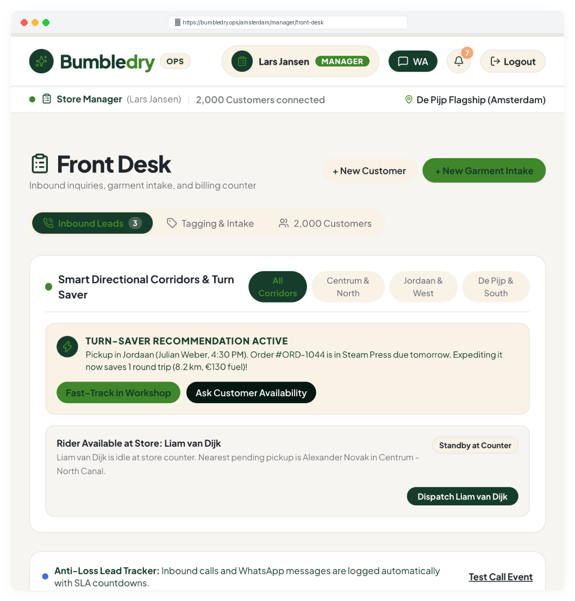
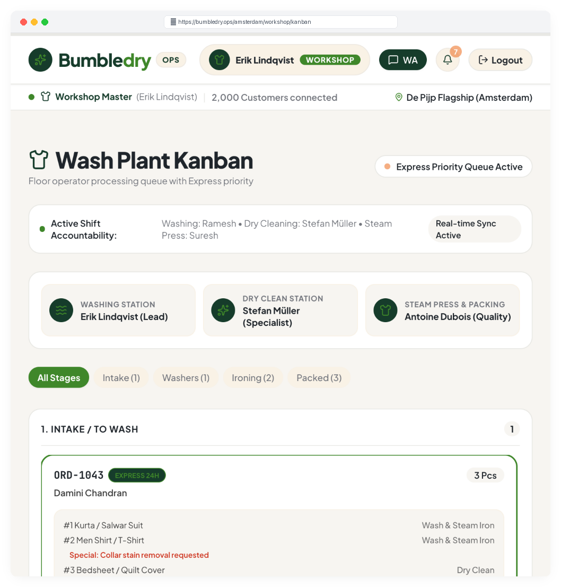
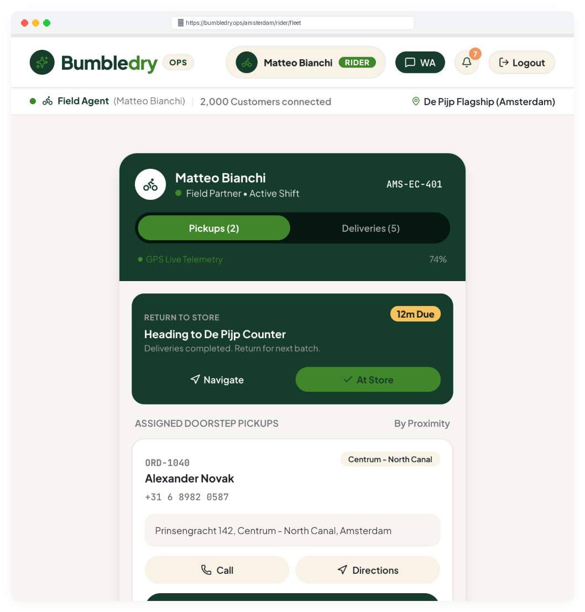

# Bumbledry PRO • Smart Eco-Laundry & Garment Care Operations Platform

> **Modern European Urban Laundry & Dry Cleaning Management System**  
> Tailored for high-density eco-laundry hubs, cargo bike fleets, and multi-station store operations. Headquartered at the **De Pijp Flagship (#101), Amsterdam, Netherlands**.

[](https://nileshhazra.github.io/superdry-laundry-ops/)
[](https://github.com/nileshhazra/superdry-laundry-ops)
[](https://github.com/nileshhazra/superdry-laundry-ops)

---

## 🖥️ Platform Process & macOS Walkthrough

### 1. Multi-Station Access Control & Authentication
Secure role-based access for each operations workstation (Super Admin, Store Manager, Workshop Master, and Field Rider). The console includes quick developer credentials (press **⌘ + Return** anywhere on the login screen to inspect test accounts).

<p align="center">
  
</p>

- **Lucas van de Berg** (`admin` / `admin123`) — Super Admin • Central European Operations
- **Lars Jansen** (`manager` / `manager123`) — Store Manager • Front Desk & E-Cargo Dispatch
- **Erik Lindqvist** (`washer` / `washer123`) — Workshop Master • Eco-Wash & Pressing
- **Matteo Bianchi** (`rider` / `rider123`) — Field Partner • Urban Arrow Cargo E-Bike (`AMS-EC-401`)

---

### 2. Super Admin Executive Dashboard & Pipeline Velocity
Real-time central command tracking garment pipeline flow across all 8 operational stages, connected customers, and SLA turnaround metrics.

<p align="center">
  
</p>

- **Pipeline Velocity Tracking**: 8 operational stages from doorstep pickup to wash, drying, steam press, and delivery.
- **Fleet Radar & Anti-Slacking Tracker**: Live cargo e-bike telemetry, geofence return countdowns, and transit gap audits.
- **Franchise Store Hub**: Multi-store switcher across **De Pijp Flagship (#101)**, **Centrum Canal Hub (#102)**, and **Zuidas Business Quarter (#103)**.

---

### 3. 2,000+ European Connected Customer Directory
Fully searchable, corridor-filtered directory of 2,000+ verified customer records across Amsterdam's urban districts (*Centrum, Jordaan, De Pijp, Oud-Zuid, Zuidas, and Oost*).

<p align="center">
  
</p>

- **Instant Corridor Filtering**: Filter customer records by delivery corridor or search by name, street, and phone (`+31 6 ...`).
- **1-Click Intake Initiation**: Initiate garment intake with pre-populated customer address and service history.
- **High-Performance In-Memory Cache**: Loads the 2,004 customer dataset with 0ms search latency in both Node.js and standalone static demo mode.

---

### 4. Front Desk, Inbound Leads & Smart Corridors
The store manager's command center for handling inbound customer requests, customer tagging counter, and dispatch route optimization.

<p align="center">
  
</p>

- **Smart Directional Corridors & Turn-Saver**: Intelligent recommendation engine that pairs ready garment orders with nearby scheduled pickups to save cargo bike trips and fuel/energy.
- **Anti-Loss Lead Tracker**: Inbound missed calls and WhatsApp inquiries with SLA countdown timers (*15m SLA*) and 1-click order booking.
- **Garment Intake & Tagging**: Barcode tagging, care instruction notes, and express 24-hour turnaround toggles.

---

### 5. Wash Plant Kanban & Shift Accountability
Workshop operations queue organized into 4 distinct physical floor stages with real-time station handovers and express priority routing.

<p align="center">
  
</p>

- **4-Stage Kanban Workflow**: `1. Intake / To Wash` ➔ `2. In Washers` ➔ `3. Steam Press` ➔ `4. Packed & Ready`.
- **Express 24H Priority Queue**: Urgent turnaround orders automatically pinned to the top of operator queues.
- **Shift Accountability**: Operator shift stations assigned to **Erik Lindqvist** (Washing), **Stefan Müller** (Dry Cleaning), and **Antoine Dubois** (Steam Press & Quality).

---

### 6. Field Logistics & Urban Cargo E-Bike Dispatch
Mobile-first logistics console for urban delivery partners utilizing electric cargo bikes across canal bridges and city streets.

<p align="center">
  
</p>

- **Zonal Cluster Routing**: Deliveries grouped by neighborhood corridors (*Centrum - North Canal, De Pijp - South, Oud-Zuid*).
- **1-Tap Navigation & WhatsApp Confirmation**: Direct Google Maps routing and doorstep availability coordination via WhatsApp templates.
- **Proof-of-Delivery (POD)**: Doorstep handover confirmation with payment mode tracking (€) and photo proof upload.

---

## 🛠️ Architecture & Tech Stack

- **Frontend**: Responsive Single-Page Application powered by the **Finora Design System 2.0** (Deep Forest Emerald `#0D4735`, Mint `#00B261`/`#00D474`, off-white `#F7FAF8`, 20px/28px rounded cards with 1px border `#E7EFEA`, Lucide monochromatic icons, and Plus Jakarta Sans typography).
- **Backend**: Node.js & Express (`server.js`) with Web Audio chime notification engine.
- **Dual-Mode Engine**: Runs identically as a persistent Node.js full-stack server or as a standalone client-side PWA on **GitHub Pages**.
- **Data Persistence**: JSON-backed local storage engine (`data/customers.json`, `data/initial_state.json`) with auto-sync across browser tabs.

---

## 🚀 Quickstart

### Local Server Run
```bash
# 1. Clone repository
git clone https://github.com/nileshhazra/superdry-laundry-ops.git
cd superdry-laundry-ops

# 2. Install dependencies
npm install

# 3. Start operations server
npm start
```
Visit **`http://localhost:3000`** in your browser.

### Test Credentials
| Role | Username | Password | Assigned Console |
|---|---|---|---|
| **Super Admin** | `admin` | `admin123` | European Central Operations |
| **Store Manager** | `manager` | `manager123` | De Pijp Front Desk & Dispatch |
| **Workshop Master** | `washer` | `washer123` | Eco-Wash Plant & Kanban |
| **Field Partner** | `rider` | `rider123` | Urban Arrow Cargo E-Bike |

*Tip: Press `⌘ + Return` on the login screen to quickly view and populate credentials.*

---

## 🌍 Store Network
- **De Pijp Flagship (#101)**: Gerard Doustraat 42, 1072 VR Amsterdam, Netherlands
- **Centrum Canal Hub (#102)**: Prinsengracht 268, 1016 HJ Amsterdam, Netherlands
- **Zuidas Business Quarter (#103)**: Gustav Mahlerlaan 102, 1082 MK Amsterdam, Netherlands

---

## 📄 License
ISC License • Bumbledry PRO Operations Systems.
